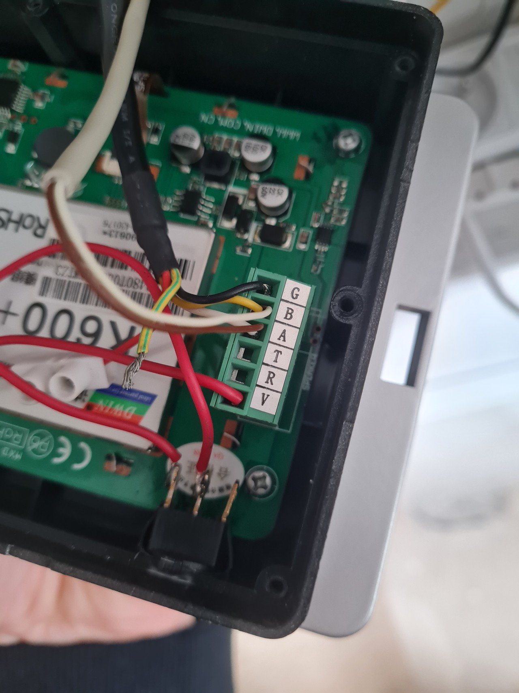
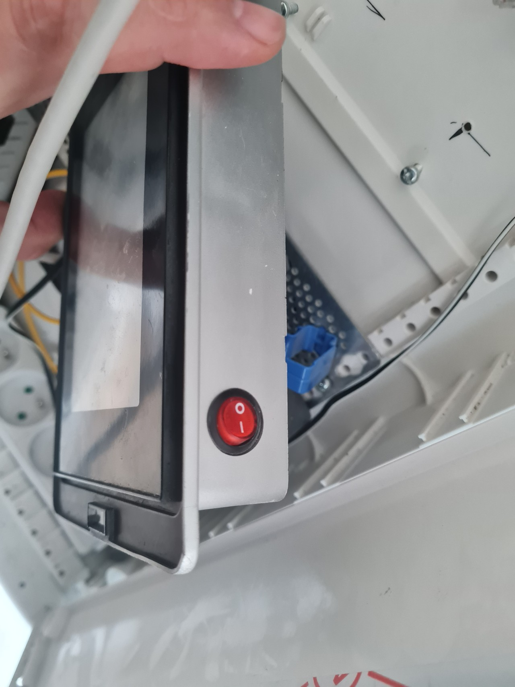
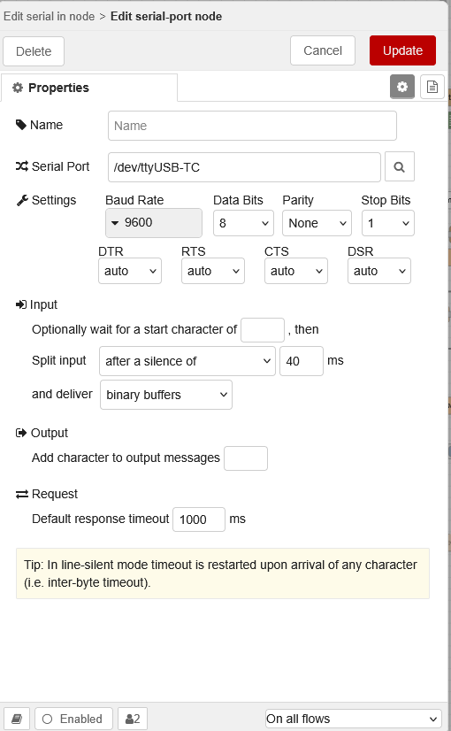
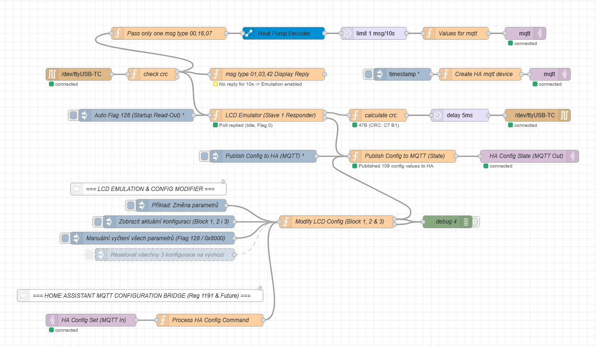
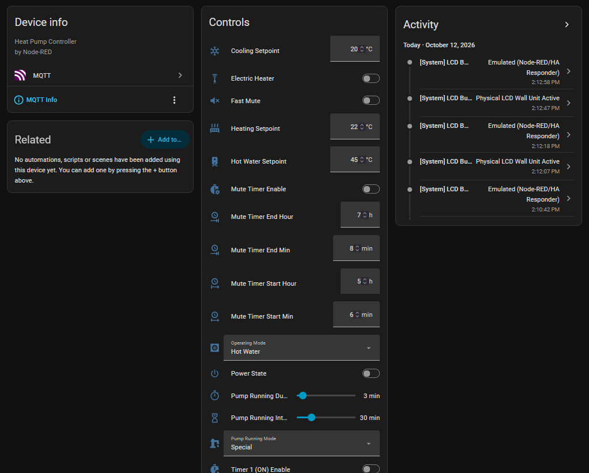

**Languages / Jazyky:** [English](README.md) | [Čeština](README.cz.md)

---

# Tepelné čerpadlo vzduch-voda Nordline (N8A) – Integrace Modbus a Home Assistant

Obousměrné monitorování, telemetrie a plné konfigurační řízení pro tepelné čerpadlo **Nordline N8A vzduch-voda** (vybavené řídicí deskou **PC8002 PCB** a nástěnnou LCD jednotkou **Slave 1**).

Tento projekt integruje tepelné čerpadlo do systému **Home Assistant** prostřednictvím sběrnice **RS-485 Modbus RTU**, **Node-RED** a protokolu **MQTT**. Zahrnuje:
- **Živá telemetrie a diagnostika**: 42 stavových senzorů (teploty vody a chladiva, tlaky chladiva, frekvence invertoru kompresoru, elektrické parametry, kroky elektronického expanzního ventilu EEV, otáčky ventilátoru, výstupní relé a alarmy).
- **Kompletní konfigurace a ovládání**: 109 registrů (21 hlavních ovládacích prvků pro ovládací panely jako požadované teploty topení/TUV, provozní režimy, časovač tichého režimu a režimy oběhového čerpadla + 88 pokročilých servisních parametrů).
- **Koexistence a dynamický failover (10sekundový watchdog)**: Inteligentní přepínání mezi fyzickým nástěnným LCD ovladačem a emulátorem LCD v Node-RED pro zamezení kolizí paketů na sběrnici RS-485.
- **Automatické vyhledávání v Home Assistant přes MQTT Discovery**: Okamžité automatické vytvoření všech entit zařízení, ovládacích prvků, číselníků, přepínačů, výběrových polí a telemetrických senzorů se strukturovaným řazením a seskupením.

---

## Obsah
1. [Architektura systému](#architektura-systému)
2. [Požadavky na hardware](#požadavky-na-hardware)
3. [Zapojení a přídavný vypínač napájení](#zapojení-a-přídavný-vypínač-napájení)
4. [Požadavky na software](#požadavky-na-software)
5. [Doplňky a uzly pro Node-RED](#doplňky-a-uzly-pro-node-red)
6. [Nastavení sériového portu](#nastavení-sériového-portu)
7. [Instalace a konfigurace](#instalace-a-konfigurace)
8. [Integrace do Home Assistant a uživatelské rozhraní](#integrace-do-home-assistant-a-uživatelské-rozhraní)
9. [Bezpečnostní a ochranné mechanismy](#bezpečnostní-a-ochranné-mechanismy)
10. [Referenční dokumentace](#referenční-dokumentace)

---

## Architektura systému

```text
+-----------------------+                    +---------------------------+
| Fyzický nástěnný LCD  |                    | USB-RS485 převodník       |
| ovladač (Slave ID 1)  |<---+          +--->| (např. /dev/ttyUSB-TC)    |
+-----------------------+    |          |    +---------------------------+
                             |  RS-485  |                  |
+-----------------------+    | dvoudrát |                  v
| Řídicí deska čerpadla |----+ sběrnice +            +------------+
| (PC8002 PCB)          |                            |  Node-RED  |
+-----------------------+                            +------------+
                                                           |  MQTT
                                                           v
                                                     +------------+
                                                     | Home Asst. |
                                                     +------------+
```

1. **Hlavní řídicí deska (PC8002 PCB - Master)** cyklicky každou sekundu vysílá broadcasty se stavem (`00, 16, 07` a `00, 16, 08`) a dotazuje se LCD displeje (`01, 03, 0B, B9, 00, 15`).
2. **Node-RED** je ke sběrnici připojen prostřednictvím galvanicky odděleného USB-RS485 převodníku.
3. Pokud je fyzický LCD ovladač aktivní, Node-RED pouze pasivně naslouchá veškerým rámcům na sběrnici (telemetrie pouze pro čtení).
4. Pokud je fyzický LCD ovladač odpojen nebo vypnut přídavným vypínačem po dobu delší než 10 sekund, emulátor LCD v Node-RED automaticky převezme odpovídání na dotazy Masteru a synchronizaci parametrů z Home Assistant.
5. Všechny telemetrické veličiny a stavy konfigurace jsou publikovány přes **MQTT** s automatickým vyhledáváním pro Home Assistant.

---

## Požadavky na hardware

Pro zprovoznění tohoto řešení budete potřebovat:
1. **Tepelné čerpadlo Nordline N8A** (nebo kompatibilní jednotku s řídicí deskou PC8002 PCB).
2. **USB-RS485 adaptér**:
   - Důrazně doporučujeme galvanicky oddělený USB-RS485 převodník na bázi FTDI, CH340 nebo CP2102, který ochrání váš hostitelský systém před zemními smyčkami a přepětím.
3. **Stíněný kroucený kabel**:
   - Dvoudrátový nebo třídrátový kabel pro propojení signálů `A (Data+)`, `B (Data-)` a volitelně `G (GND)` sběrnice RS-485.
4. **Přídavný kolébkový vypínač napájení (volitelný, ale doporučený)**:
   - Malý přepínač instalovaný do krytu nástěnné LCD jednotky přerušující napájecí vodič `V (VCC)`.
   - Umožňuje okamžité a bezpečné přepínání mezi fyzickým nástěnným panelem a emulátorem v Node-RED.
5. **Domácí server / jednodeskový počítač (SBC)**:
   - Raspberry Pi, Intel NUC, Home Assistant Yellow/Green nebo virtuální stroj s Linuxem provozující Home Assistant, MQTT broker (Mosquitto) a Node-RED.

---

## Zapojení a přídavný vypínač napájení

### 1. Zapojení svorkovnice
Uvnitř nástěnného LCD ovladače se nachází 6pólová svorkovnice:

| Svorka | Funkce | Zapojení vodiče |
|:------:|:-------|:----------------|
| **G** | Zem (GND) | Společná zem s adaptérem RS-485 / tepelným čerpadlem |
| **B** | RS-485 Data - | Připojeno k lince RS-485 **B / D-** |
| **A** | RS-485 Data + | Připojeno k lince RS-485 **A / D+** |
| **T** | TX (Interní) | Nezapojeno |
| **R** | RX (Interní) | Nezapojeno |
| **V** | Napájení (+12V/+24V) | Připojeno přes **přídavný vypínač napájení** |



### 2. Instalace přídavného vypínače napájení
Jelikož je RS-485 sběrnice s jedním Masterem, současné odpovídání dvou zařízení na adresu Slave 1 způsobuje elektrické kolize a chyby rámců (framing/CRC errors).

Pro čisté přepínání mezi fyzickým ovládáním a automatizací v Node-RED byl do série s napájecí svorkou **V** zapojen červený kolébkový vypínač:



- **Vypínač ZAPNUT (ON)**: Fyzický LCD displej je napájen a odpovídá na dotazy řídicí desky (Master). Node-RED automaticky detekuje pakety `01, 03, 42 Display Reply`, okamžitě deaktivuje svůj interní emulátor a přechází do čistě pasivního režimu odposlechu.
- **Vypínač VYPNUT (OFF)**: Fyzický LCD displej je bez napájení. Po 10 sekundách ticha na sběrnici vyprší 10sekundový watchdog v Node-RED a interní emulátor LCD automaticky převezme odpovídání na dotazy Masteru i zpracování příkazů z Home Assistant.

---

## Požadavky na software

1. **Home Assistant**: Core 2023.x nebo novější s aktivovanou nativní integrací **MQTT**.
2. **MQTT Broker**: **Mosquitto Broker** (doplněk v Home Assistant OS nebo samostatný Docker kontejner).
3. **Node-RED**: Verze 2.x, 3.x nebo 4.x provozovaná jako doplněk Home Assistant nebo kontejner.

---

## Doplňky a uzly pro Node-RED

Poskytnutý tok (`flows.json`) vyžaduje následující doplňkové balíčky uzlů:

### Požadované balíčky:
1. **`node-red-contrib-buffer-parser`**:
   - Dekóduje a sestavuje složité binární Modbus rámce na čísla, booleany a bitová pole.
2. **`node-red-node-serialport`**:
   - Zajišťuje přímou obousměrnou komunikaci s převodníkem USB-RS485 v Linuxu i Windows.

### Instalace přes Správce palety v Node-RED:
1. V Node-RED otevřete hlavní menu vpravo nahoře -> **Spravovat paletu** (Manage palette) -> záložka **Instalovat** (Install).
2. Vyhledejte a nainstalujte:
   - `node-red-contrib-buffer-parser`
   - `node-red-node-serialport`

*(Všechny ostatní uzly — `mqtt in`, `mqtt out`, `function`, `delay`, `file`, `inject` a `debug` — jsou nativní součástí jádra Node-RED).*

---

## Nastavení sériového portu

V konfiguračním uzlu `serial-port` v Node-RED nastavte následující parametry:

| Vlastnost | Hodnota | Popis |
|:---|:---|:---|
| **Sériový port** | `/dev/ttyUSB-TC` *(nebo váš port / COM)* | Cesta k zařízení v Linuxu nebo symlink |
| **Přenosová rychlost** | `9600` | Rychlost Modbus sběrnice tepelného čerpadla |
| **Datové bity** | `8` | Standardní Modbus RTU |
| **Parita** | `Žádná` (None) | Bez paritního bitu |
| **Stop bity** | `1` | 1 stop bit |
| **Řízení toku** | DTR: auto, RTS: auto, CTS: auto, DSR: auto | Bez hardwarového handshakingu |
| **Rozdělení vstupu** | Po odmlce trvající **`40 ms`** | Zajišťuje doručení celistvých rámců |
| **Doručovat jako** | `binární buffery` (binary buffers) | Nativní objekty typu Buffer |
| **Časový limit odezvy**| `1000 ms` | Výchozí limit 1 sekunda |



---

## Instalace a konfigurace

1. **Import toku**:
   - V Node-RED otevřete nabídku vpravo nahoře -> **Importovat** (Import).
   - Vyberte a importujte soubor [`flows.json`](flows.json).
2. **Konfigurace MQTT brokera**:
   - Dvakrát klikněte na konfigurační uzel `mqtt` broker.
   - Nastavte IP adresu serveru (např. `127.0.0.1` nebo IP Home Assistant), port `1883` a přihlašovací údaje k MQTT.
3. **Konfigurace sériového portu**:
   - Dvakrát klikněte na uzel `/dev/ttyUSB-TC` a ověřte správnost cesty k sériovému portu.
4. **Nasazení (Deploy)**:
   - Klikněte na tlačítko **Nasadit** (Deploy) v pravém horním rohu Node-RED.
   - Po spuštění tok aktivuje 10sekundovou ochrannou lhůtu ticha, inicializuje telemetrii a odešle zprávy MQTT Discovery do Home Assistant.



---

## Integrace do Home Assistant a uživatelské rozhraní

Po nasazení toku uzel `Create HA mqtt device` publikuje konfigurační zprávy MQTT Discovery do tématu `homeassistant/#`. Tepelné čerpadlo se v Home Assistant zobrazí jako jedno ucelené zařízení s názvem **Heat Pump**:



### Logické řazení a taxonomie entit:
Entity jsou strukturovány tak, aby se na kartách zařízení Home Assistant přirozeně a logicky řadily:
- **Ovládací prvky (21 hlavních prvků v kartě Ovládání)**: Přehledné názvy bez závorek pro rychlé ovládání:
  - `Power State` (Vypínač: `switch.hp_power_state`)
  - `Operating Mode` (Provozní režim: `select.hp_operating_mode`)
  - `Heating Setpoint`, `Hot Water Setpoint`, `Cooling Setpoint` (Požadovaná teplota topení, TUV, chlazení)
  - `Fast Mute`, `Mute Timer Enable / Start / End` (Rychlý tichý režim, plánovač tichého režimu)
  - `Electric Heater`, `Daily Timer 1 & 2 Schedules` (Záložní elektrokotel, denní časovače 1 a 2)
  - `Pump Running Mode / Interval / Duration` (Režim, interval a doba běhu čerpadla)
- **Konfigurace (88 pokročilých servisních registrů)**: Seskupeno podle kategorií s jednotnou předponou:
  - `[System]`, `[Protect]`, `[Fan]`, `[Defrost]`, `[EEV]`, `[Disinf]`, `[Pump]`, `[Temp]`
- **Senzory a diagnostika (42 telemetrických senzorů)**:
  - `[Temp]`: Teploty vody (Vstupní, Výstupní, Bojler TUV), Chladivo (Sání, Výtlak, Výparník, Přehřátí), Systém (Venkovní okolí, Invertor, Ochrana modulu)
  - `[Pressure]`: Tlakový snímač sání LP, Tlakový snímač výtlaku HP
  - `[Electrical]`: Napětí sítě AC, Proud sítě AC, Napětí DC sběrnice, Fázový proud kompresoru
  - `[Fan]`: Otáčky ventilátoru, Požadované otáčky
  - `[EEV]`: Kroky elektronického expanzního ventilu
  - `[System]`: Požadovaná frekvence, Aktuální frekvence, Stav napájení ON/OFF, Status
  - `[Output]`: Výstupní relé O01 až O13
  - `[Alarm]`: Bezpečnostní spínače S01 až S07 a aktivní číselný kód chyby

---

## Bezpečnostní a ochranné mechanismy

1. **Dvoustupňový 10sekundový watchdog ticha LCD ovladače**:
   - **Okamžité vypnutí emulace**: Jakýkoliv příchozí paket `01, 03, 42 Display Reply` z fyzického LCD ovladače okamžitě deaktivuje emulaci v paměti (`flow.set("lcd_emulator_enabled", false)`).
   - **Aktivace po 10 sekundách ticha**: Emulátor LCD v Node-RED začne odpovídat na dotazy Masteru teprve tehdy, pokud po dobu nejméně 10 sekund nebyl zachycen žádný paket od fyzického LCD panelu.
   - **Ochrana při opětovném zapnutí**: Pokud je fyzický vypínač zapnut, hned první přijatý paket okamžitě odpojí emulátor Node-RED, čímž je zaručena nulová kolize na lince RS-485.
2. **Ochrana proti neúplné synchronizaci při startu (Flag 128 / 0x8000)**:
   - Při startu toku Node-RED nebo převzetí emulace zařadí do fronty příznak Flag 128, kterým si od řídicí desky vyžádá vyčtení všech 270 konfiguračních registrů.
   - Zápisy parametrů z Home Assistant jsou **zablokovány**, dokud nejsou všechny registry načteny v paměti, což brání nechtěnému přepsání parametrů výchozími nulami.
3. **Validace kontrolních součtů CRC-16 a rámců**:
   - Každý přijatý rámec je před dekódováním nebo přeposláním ověřen pomocí algoritmu Modbus CRC-16.

---

## Referenční dokumentace

- [`heatpump_configuration_registers.cz.txt`](heatpump_configuration_registers.cz.txt) / [Anglická verze (`heatpump_configuration_registers.txt`)](heatpump_configuration_registers.txt): Kompletní servisní mapa 270 registrů, rozsahy parametrů, přepočty a tovární kódy.
- [`heatpump_rs485_protocol_spec.cz.txt`](heatpump_rs485_protocol_spec.cz.txt) / [Anglická verze (`heatpump_rs485_protocol_spec.txt`)](heatpump_rs485_protocol_spec.txt): Podrobná specifikace reverzního inženýrství protokolu Modbus, časování rámců a stavové automaty.
- [`Nordline_N8A_Manual.pdf`](Nordline_N8A_Manual.pdf): Oficiální servisní manuál výrobce k desce PC8002 PCB a schémata elektrického zapojení.
